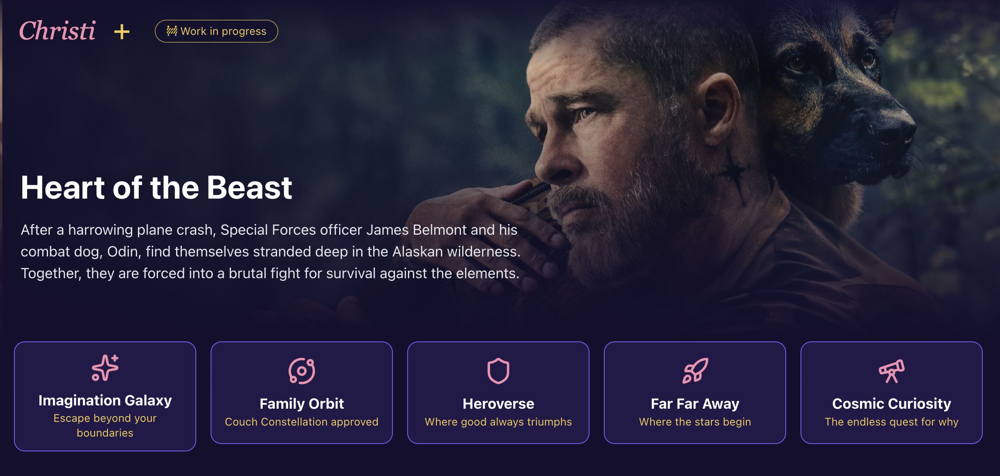
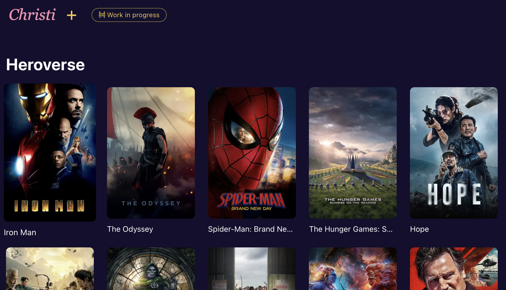

# Christi+ | Galaxy Glam Streaming App

A space-themed streaming app inspired by Disney+, built with Next.js, TypeScript, and Tailwind CSS.

**Live site:** https://christiplus.beautifulyouwebstudio.com

## Features
- Auto-sliding hero carousel with the most popular movies
- Scrollable movie rows with arrow controls
- "Galaxy" tiles that open dynamic genre pages
- Live movie data from the TMDB API
- Keyboard navigation with visible focus rings
- Deployed on Vercel with a custom domain

## Built With
- Next.js 14 (App Router)
- TypeScript
- Tailwind CSS
- shadcn/ui
- Embla Carousel
- TMDB API

## What I Learned
- Fetching data on the server with async/await
- Building dynamic routes with `[id]` folders
- Styling with Tailwind classes and custom theme colors
- Making a site usable without a mouse

## Coming in v2
- Search and a genre dropdown
- User login
- AI movie suggestions
- Butterfly intro animation

## Run It Locally
1. Clone the repo and run `npm install`
2. Create a `.env.local` file with `TMDB_API_KEY=your_key_here`
3. Run `npm run dev` and open http://localhost:3000

## Author
**Christi Hansen Moore** | Beautiful You Web Studio

---
*This product uses the TMDB API but is not endorsed or certified by TMDB.*